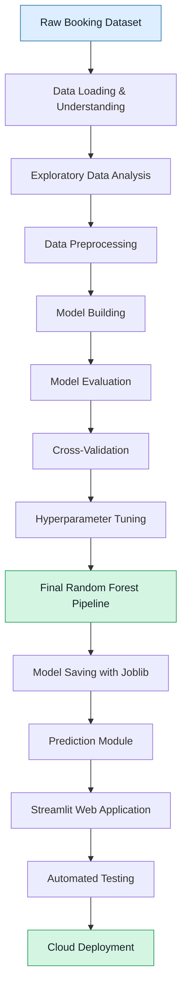

<div align="center">

# 🏨 Hotel Booking Cancellation Prediction System

### End-to-End Machine Learning Classification Project

**Predict hotel booking cancellations using Machine Learning and explore booking patterns through an interactive web application.**

<br>

<a href="https://hotel-booking-cancellation-prediction-a76m8cdtmqdpuj5qkuqpti.streamlit.app/">
  
</a>
<a href="https://github.com/mahmoud1641998/Hotel-Booking-Cancellation-Prediction">
  
</a>

<br><br>


<br>


</div>

---

## 📌 Project Overview

The **Hotel Booking Cancellation Prediction System** is an end-to-end Supervised Machine Learning project designed to predict whether a hotel booking will be **Canceled** or **Not_Canceled**.

Using historical hotel booking records, the project explores booking patterns, performs data analysis and preprocessing, builds and evaluates multiple classification models, and selects an optimized Random Forest model.

The final model is integrated into an interactive **Streamlit Web Application** that allows users to:

- Predict whether a booking is likely to be canceled.
- View cancellation and non-cancellation probabilities.
- Explore booking statistics and cancellation patterns.
- Interact with data visualizations through a simple interface.

The project covers the complete Machine Learning workflow, from data exploration to model deployment and automated testing.

## 🎯 Project Objectives

- Explore and understand hotel booking data.
- Identify patterns and relationships associated with booking cancellations.
- Prepare numerical and categorical features for Machine Learning.
- Build and compare multiple classification algorithms.
- Evaluate models using appropriate classification metrics.
- Apply Stratified K-Fold Cross-Validation.
- Optimize the selected model using hyperparameter tuning.
- Develop reusable preprocessing and prediction modules.
- Build and deploy an interactive Streamlit application.
- Implement automated tests to verify core functionality.

---

## 📊 Dataset Description

The dataset contains **36,285 booking records** and **17 columns**.

| Property | Description |
|---|---|
| Total Records | 36,285 |
| Total Columns | 17 |
| Numerical Features Used | 11 |
| Categorical Features Used | 3 |
| Total Input Features | 14 |
| Target Variable | `booking status` |
| Problem Type | Binary Classification |

### Target Variable Distribution

The target variable is `booking status`, which contains two classes:

| Class | Description | Records | Percentage |
|---|---|---:|---:|
| Not_Canceled | Booking was not canceled | 24,396 | 67.23% |
| Canceled | Booking was canceled | 11,889 | 32.77% |
| **Total** | | **36,285** | **100%** |

### Features Used

**Numerical Features**

- `number of adults`
- `number of children`
- `number of weekend nights`
- `number of week nights`
- `car parking space`
- `lead time`
- `repeated`
- `P-C`
- `P-not-C`
- `average price`
- `special requests`

**Categorical Features**

- `type of meal`
- `room type`
- `market segment type`

### Excluded Columns

- `Booking_ID`: Excluded because it is an identifier rather than a meaningful predictive feature.
- `date of reservation`: Excluded because its meaning and availability at prediction time were not sufficiently established.
- `booking status`: Used as the target variable, not as an input feature.

The final model uses **14 input features**.

---

## 🔄 Project Workflow

The project follows a structured end-to-end Machine Learning workflow:



### Workflow Details

**1. Data Loading and Understanding**
- Load the dataset.
- Inspect its structure, data types, and distributions.
- Examine missing values and duplicate records.

**2. Exploratory Data Analysis (EDA)**
- Analyze numerical and categorical features.
- Investigate relationships between features and the target variable.
- Perform correlation analysis.
- Review unusual values and feature distributions.

**3. Data Preprocessing**
- Split the data into training and testing sets using stratified sampling.
- Apply One-Hot Encoding to categorical features.
- Apply Standard Scaling to numerical features in the preprocessing workflow.
- Encode the target variable.
- Fit preprocessing transformations on training data only to avoid data leakage.

**4. Model Building and Evaluation**
- Train and evaluate multiple classification algorithms.
- Compare training and testing performance.
- Apply Stratified K-Fold Cross-Validation.
- Evaluate cancellation-specific Precision, Recall, and F1-score.

**5. Hyperparameter Tuning**
- Use `RandomizedSearchCV` to optimize the Random Forest model.
- Apply 5-fold Stratified Cross-Validation.
- Optimize the F1-score of the `Canceled` class.

**6. Model Saving and Prediction**
- Save the selected fitted pipeline using Joblib.
- Reload the saved model.
- Verify prediction consistency.
- Implement reusable prediction functions.

**7. Streamlit Application**
- Build a home page with project information and model performance.
- Develop an interactive booking prediction page.
- Create a data insights page with visualizations.

**8. Automated Testing and Deployment**
- Test preprocessing functionality.
- Test model loading and prediction.
- Validate prediction probabilities and output shapes.
- Deploy the application to Streamlit Community Cloud.

---

## 🤖 Model Development

The following classification algorithms were implemented and evaluated:

| Model | Algorithm |
|---|---|
| 1 | Logistic Regression |
| 2 | Decision Tree |
| 3 | Random Forest |
| 4 | Gradient Boosting |
| 5 | Support Vector Classifier (SVC) |

### Model Evaluation

Model evaluation included:

- Accuracy
- Precision
- Recall
- F1-score
- Confusion Matrix
- ROC-AUC
- Stratified K-Fold Cross-Validation

The initial Random Forest model achieved the strongest overall performance among the evaluated models and was selected for further optimization.

### ⭐ Final Model: Tuned Random Forest Pipeline

Hyperparameter optimization was performed using `RandomizedSearchCV`.

**Tuning Configuration**

| Parameter | Value |
|---|---:|
| Parameter Combinations | 30 |
| Cross-Validation Folds | 5 |
| Optimization Metric | F1-score for `Canceled` |
| Random State | 42 |

**Best Hyperparameters**

| Hyperparameter | Selected Value |
|---|---|
| `n_estimators` | 100 |
| `max_depth` | 20 |
| `min_samples_split` | 10 |
| `min_samples_leaf` | 1 |
| `max_features` | `sqrt` |
| `bootstrap` | `False` |

The final fitted pipeline includes categorical preprocessing and the Random Forest classifier.

It accepts raw booking features and performs the required categorical preprocessing internally, making it suitable for integration into the prediction application.

---

## 🏆 Final Model Performance

The final model was evaluated using the held-out test set.

<div align="center">

| Accuracy | Canceled Precision | Canceled Recall | Canceled F1-score |
|:---:|:---:|:---:|:---:|
| **89.31%** | **87.43%** | **78.68%** | **82.82%** |

</div>

### Confusion Matrix

Class order: `Canceled`, `Not_Canceled`.

| Actual / Predicted | Canceled | Not_Canceled |
|---|---:|---:|
| **Canceled** | 1,871 | 507 |
| **Not_Canceled** | 269 | 4,610 |

The model correctly identified:

- **1,871** canceled bookings.
- **4,610** bookings that were not canceled.

> **Evaluation Focus:** Cancellation-specific Precision, Recall, and F1-score focus on the `Canceled` class because identifying potential cancellations is the main objective of this project.

---

## 🖥️ Streamlit Web Application

The trained model is integrated into an interactive Streamlit application with three pages.

<div align="center">

### 🚀 Explore the Live Application

[](https://hotel-booking-cancellation-prediction-a76m8cdtmqdpuj5qkuqpti.streamlit.app/)

</div>

### 1. 🏠 Home

Provides an overview of the project, its objectives, workflow, and final model performance.

### 2. 🔮 Booking Prediction

Allows users to enter booking information and receive:

- Predicted booking status.
- Cancellation probability.
- Non-cancellation probability.
- Visual comparison of prediction probabilities.

### 3. 📈 Data Insights

Provides descriptive analysis and visualizations of the complete original booking dataset, including:

- Booking status distribution.
- Cancellation rate by market segment.
- Cancellation rate by room type.
- Average lead time by booking status.

**Note:** The Data Insights page analyzes the original dataset, while model evaluation is performed separately using the held-out test set.

---

## 🧪 Automated Testing

The project includes automated tests for preprocessing and prediction functionality.

Run the complete test suite from the project root:

```bash
python -m pytest -v
```

### Test Results

| Test Module | Number of Tests | Status |
|---|---:|---|
| `test_preprocessing.py` | 5 | ✅ Passed |
| `test_prediction.py` | 7 | ✅ Passed |
| **Total** | **12** | **✅ All Passed** |

**Verification:** All 12 automated tests passed successfully in the local development environment.

---

## 🧰 Technologies Used

<div align="center">


&nbsp;&nbsp;

&nbsp;&nbsp;

&nbsp;&nbsp;

&nbsp;&nbsp;

&nbsp;&nbsp;

&nbsp;&nbsp;

&nbsp;&nbsp;


</div>

| Technology | Purpose |
|---|---|
| Python | Main programming language |
| Pandas | Data manipulation and analysis |
| NumPy | Numerical operations |
| Scikit-learn | Preprocessing, model training, evaluation, and tuning |
| Joblib | Model serialization and loading |
| Streamlit | Interactive web application |
| Matplotlib & Seaborn | Data visualization |
| Jupyter Notebook | Exploratory analysis and model development |
| Pytest | Automated testing |
| Git & GitHub | Version control and project hosting |

---

## 📁 Project Structure

```text
Hotel-Booking-Cancellation-Prediction/
│
├── app/
│   ├── Home.py
│   └── pages/
│       ├── 1_Booking_Prediction.py
│       └── 2_Data_Insights.py
│
├── data/
│   ├── raw/
│   │   └── booking.csv
│   └── processed/
│
├── notebooks/
│   ├── EDA.ipynb
│   ├── Data_Preprocessing.ipynb
│   └── Model_Building.ipynb
│
├── src/
│   ├── __init__.py
│   ├── data_loader.py
│   ├── evaluate.py
│   ├── predict.py
│   └── preprocessing.py
│
├── models/
│   └── best_random_forest_pipeline.joblib
│
├── tests/
│   ├── test_prediction.py
│   └── test_preprocessing.py
│
├── reports/
│   └── figures/
│
├── .gitignore
├── LICENSE
├── requirements.txt
└── README.md
```

---

## ⚙️ Installation and Setup

### 1. Clone the Repository

```bash
git clone https://github.com/mahmoud1641998/Hotel-Booking-Cancellation-Prediction.git
```

### 2. Navigate to the Project Directory

```bash
cd Hotel-Booking-Cancellation-Prediction
```

### 3. Create a Virtual Environment

```bash
python -m venv venv
```

### 4. Activate the Environment

**Windows**

```bash
venv\Scripts\activate
```

**Linux / macOS**

```bash
source venv/bin/activate
```

### 5. Install Dependencies

```bash
pip install -r requirements.txt
```

---

## ▶️ Running the Application

From the project root directory, run:

```bash
streamlit run app/Home.py
```

Streamlit will start the application and provide a local URL, usually:

```text
http://localhost:8501
```

---

## 🔮 Future Improvements

Potential extensions for future versions include:

- Adding more interactive data exploration capabilities.
- Investigating additional feature engineering approaches.
- Experimenting with other classification algorithms and tuning strategies.
- Monitoring model performance as new booking data becomes available.
- Expanding automated tests to cover additional application scenarios.

---

## ✅ Project Status


The complete Machine Learning workflow, final tuned model, Streamlit application, automated tests, GitHub repository, and cloud deployment have been completed.

All three online application pages were successfully tested and verified.

---

## 👨‍💻 Author

**Mahmoud Abdelnaby**

AI & Data Science Instructor | Machine Learning

[](https://www.linkedin.com/in/mahmoud-abdelnaby-6b53b9297/)
[](https://github.com/mahmoud1641998)

---

<div align="center">

**Built as a practical demonstration of an end-to-end Machine Learning workflow.**

⭐ Feel free to explore the repository and try the live application!

</div>
